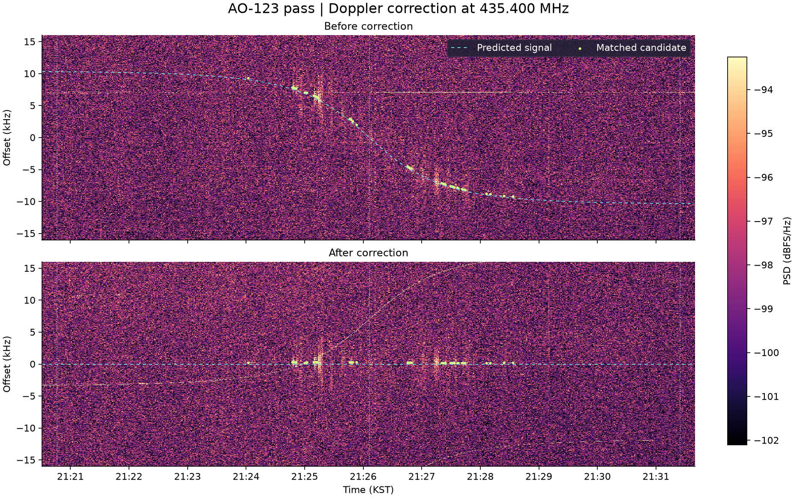

# PlutoSDR 위성 수신 분석

PlutoSDR로 받은 위성 IQ를 분석한 기록과 Python 스크립트입니다.

## 수신 기록

- 2026-11-19 RS-44 (435.605 MHz). 예측 도플러에 −2,550 Hz를 더했을 때 관측 피크 33개의 잔차 RMS는 51 Hz였고, CW에서 `RS44`를 두 번 읽었습니다. [전체 기록](docs/observations/2026-11-19-rs44.md)
- 2026-11-18 AO-123 (435.400 MHz). 예측 도플러를 따라 움직인 후보의 주파수 변화 폭이 보정 후 18.52 kHz에서 146 Hz로 줄었습니다. [전체 기록](docs/observations/2026-11-18-ao123.md)

[수신과 분석 실행 방법](docs/usage.md)

## 라이선스

[MIT License](LICENSE)
