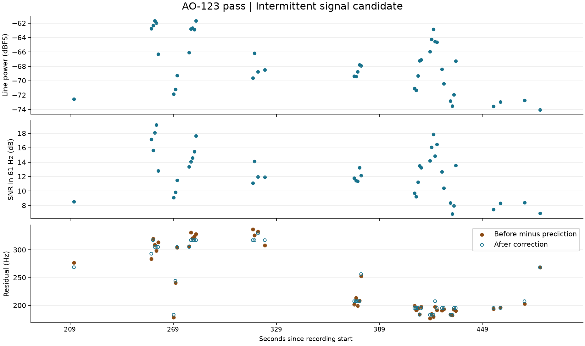
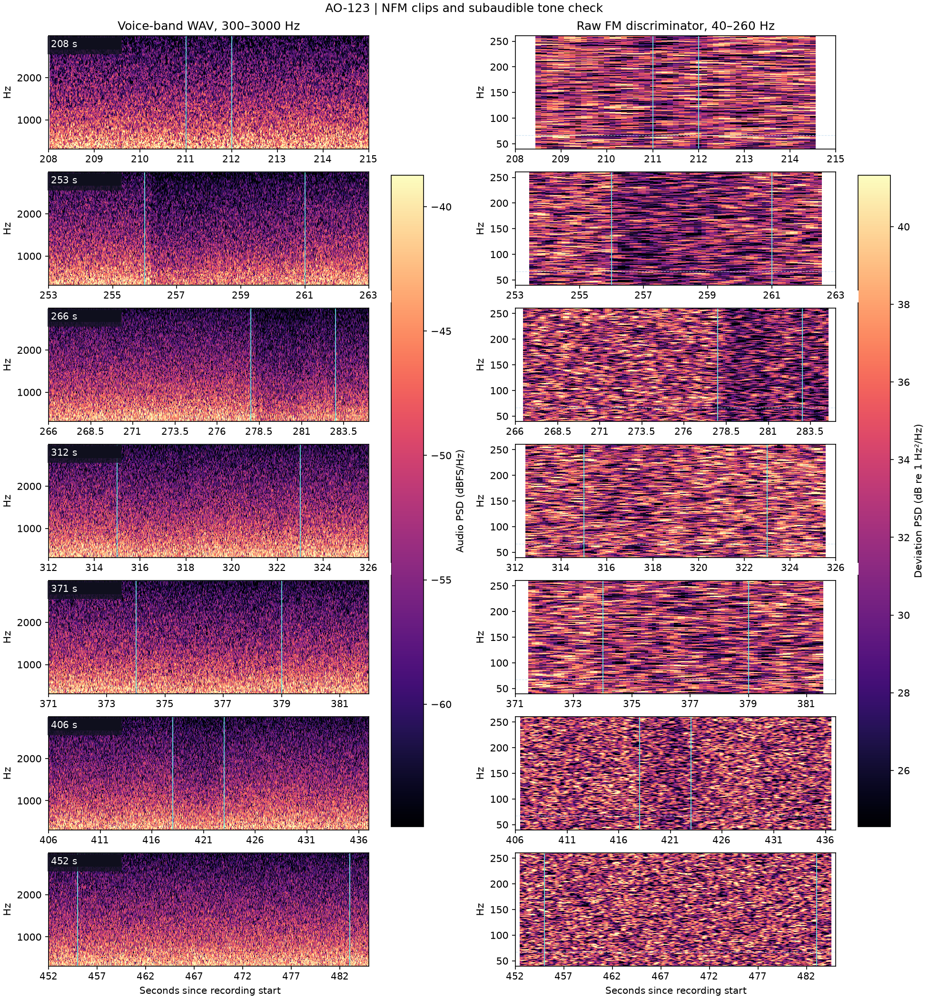
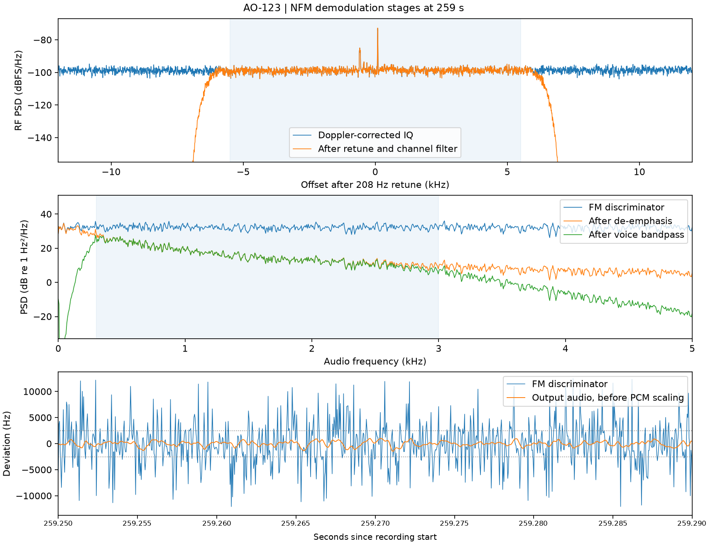

# AO-123 수신 기록 (2026-11-18)

435.400 MHz를 PlutoSDR로 기록했습니다. 그림은 21:20:31–21:31:39 KST 구간입니다. 21:24:02–21:28:33에 예측 도플러를 따르는 좁은 신호가 간헐적으로 잡혔습니다. 송신원과 변조는 특정하지 못했습니다.

## 워터폴과 도플러 보정

전체 워터폴의 하늘색 점선은 예측 도플러입니다. +7 kHz 부근에는 움직이는 후보와 별도로 수평 성분도 보입니다.

보정 전후 후보가 일치한 스냅샷은 43개입니다. 주파수 변화 폭은 18.52 kHz에서 146 Hz로 줄었습니다. 보정 전 예측 대비 편차는 +177–+337 Hz(중앙값 +203 Hz), 보정 후 0 Hz 기준 잔류는 +183–+330 Hz(중앙값 +208 Hz)였습니다.

처리 코드: [`analyze_live_doppler.py`](../../scripts/analyze_live_doppler.py), [`analyze_ao123.py`](../../scripts/analyze_ao123.py)

## 후보 세기

보정 후 +145–+375 Hz에서 PSD가 인접 잡음 중앙값보다 12 dB 이상 높은 피크를 골랐습니다. 보정 전 편차와 보정 후 잔류가 45 Hz 이내로 맞는 스냅샷만 남겼습니다. 예측 곡선 근처만 비교했습니다.

최대 후보 전력은 21:24:49의 −61.6 dBFS였습니다. 21:24:50의 최대 추정 SNR은 19.2 dB였습니다. 피크 주변 FFT 5개 bin(약 61 Hz)의 전력으로 계산했습니다.

## 협대역 FM 복조

전체 기록의 보정 전후 스펙트로그램은 같은 색상 범위로 표시했습니다. 패널 상단의 점은 RF 후보 검출 시각입니다.

후보 구간 7개를 다시 복조했습니다. 21:24:47–21:24:52와 21:25:09–21:25:14의 FM 판별기 출력에서 300–3,000 Hz 잡음 전력이 각 클립 첫 2초보다 각각 2.0 dB, 2.1 dB 줄었습니다. 67 Hz 주변 피크 대비는 최대 11.6 dB였습니다. 12 dB 이상이고 두 분석 창에서 이어지는 지속 톤은 없었습니다.

100 kS/s 보정 IQ에서 잔류 오프셋 +208 Hz를 뺀 뒤 채널 필터를 거쳐 25 kS/s에서 FM을 복조했습니다. 750 µs de-emphasis와 300–3,000 Hz 대역 필터를 적용했습니다. 21:24:50–21:24:51의 RF PSD, 판별기와 필터의 출력 PSD, 40 ms의 순간 편이와 출력 파형을 표시했습니다. ±2.5 kHz 점선은 분석 기준값입니다.

처리 코드: [`demod_nfm.py`](../../scripts/demod_nfm.py), [`analyze_ao123.py`](../../scripts/analyze_ao123.py)
