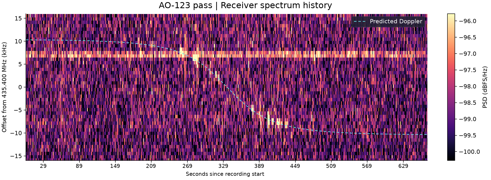
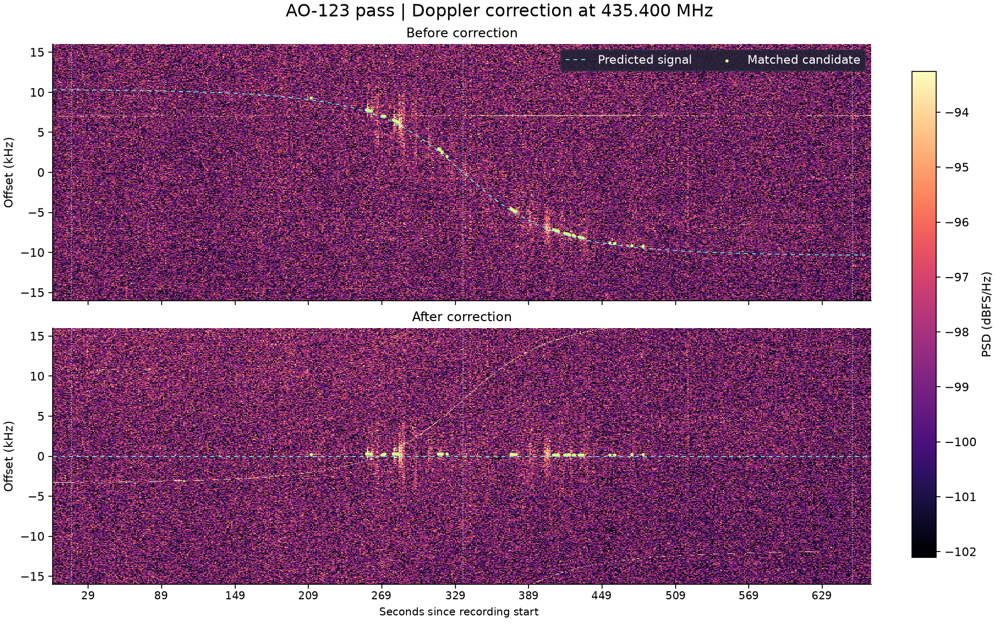
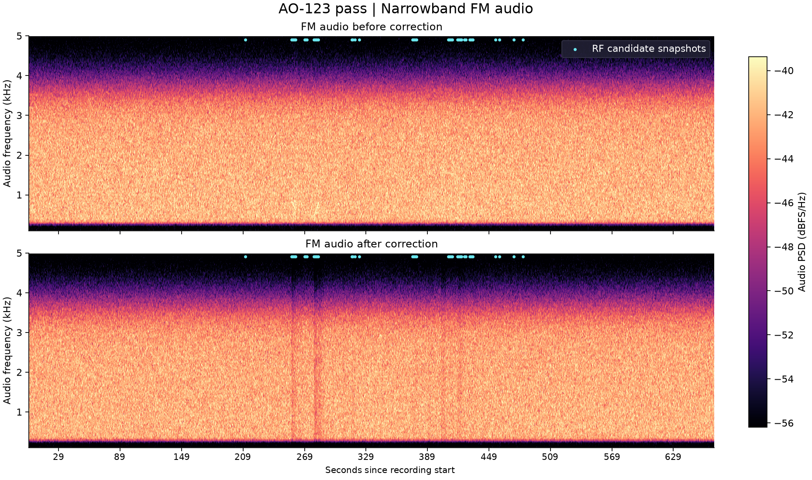

# AO-123 수신 기록 (2026-11-18)

435.400 MHz에서 예측 도플러를 따르는 협대역 신호가 간헐적으로 나타남. 송신원과 변조 미상.

- PlutoSDR, LO 435.450 MHz, RF 대역폭 500 kHz
- 3 MS/s CS16, 약 669초
- slow_attack, gain readback 73 dB

## 워터폴과 도플러 보정

하늘색 점선은 예측 도플러. +7 kHz 부근에 주파수가 고정된 다른 신호.

보정 전후 같은 후보가 잡힌 스냅샷 43개. 주파수 변화 폭은 18.52 kHz에서 146 Hz로 감소. 보정 후 남은 오프셋 중앙값 +208 Hz.

## 후보 세기

보정 후 +145–375 Hz에서 noise 중앙값보다 12 dB 이상 높은 피크를 선택. 최대 전력 −61.6 dBFS, 최대 SNR 19.2 dB. SNR은 피크 주변 약 61 Hz에서 측정.

## 협대역 FM 복조

도플러를 보정한 100 kS/s IQ에서 남은 +208 Hz 오프셋 제거. 25 kS/s로 decimation해 FM 복조. 750 µs de-emphasis와 300–3,000 Hz band-pass filter 적용.

후보 구간 7개에서 67 Hz CTCSS 톤은 배경보다 최대 11.6 dB 높음. 연속한 두 window에서 12 dB 이상 높은 톤은 없음.

처리 코드 [`analyze_live_doppler.py`](../../scripts/analyze_live_doppler.py), [`analyze_ao123.py`](../../scripts/analyze_ao123.py), [`demod_nfm.py`](../../scripts/demod_nfm.py)
