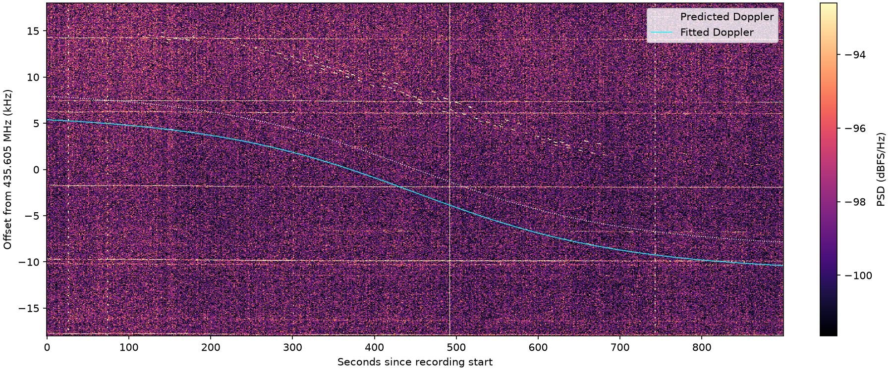
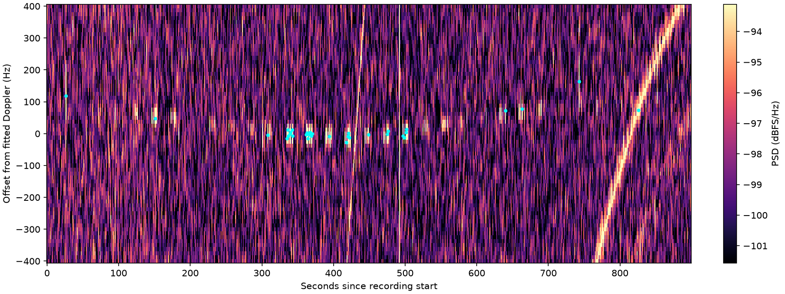
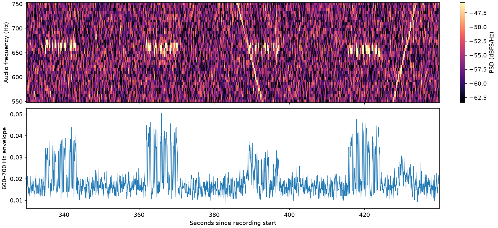

# RS-44 수신 기록 (2026-11-19)

435.605 MHz에서 CW 비콘 수신, 비콘 ID `RS44` 두 번 확인. 트랜스폰더에서 FT4 43건(고유 메시지 24개) 복조.

- PlutoSDR, LO 435.650 MHz, RF 대역폭 2 MHz
- 3 MS/s CS16, 약 900초

## 패스 워터폴

흰 점선은 예측 도플러, 하늘색 실선은 주파수 오프셋을 더한 곡선.

## 도플러 오프셋과 오차

배경보다 10 dB 이상 높은 피크 33개로 계산한 오프셋 −2,534 Hz, 보정 뒤 RMS 오차 43.5 Hz.

## CW 비콘 ID

녹음 시작 후 약 362초와 416초에 `.-. ... ....- ....-`(`RS44`) 확인.

## 트랜스폰더 신호

`ft8_lib`로 복조한 메시지 중 CRC14 통과분 집계. [AMSAT RS-44 규격](https://www.amsat.org/two-way-satellites/rs-44/)

| 주파수 | FT4 |
| --- | ---: |
| 약 435.6150 MHz | 13 |
| 약 435.6153 MHz | 20 |
| 435.6147 MHz | 1 |
| 435.61603–435.61638 MHz | 9 |

약 435.642 MHz에서 길이 2.6–2.8초의 반복 버스트. 변조 미상.

처리 코드 [`analyze_rs44.py`](../../scripts/analyze_rs44.py)
