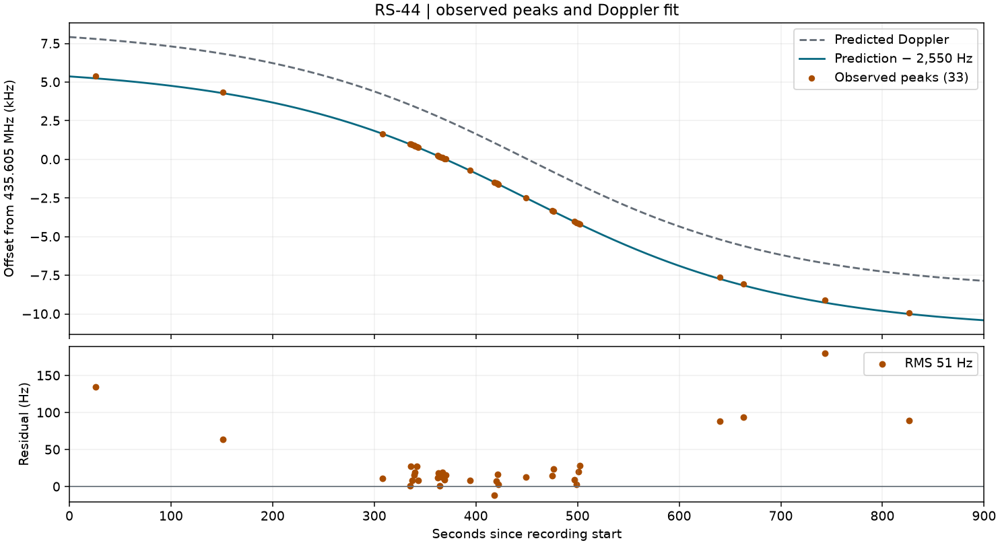

# RS-44 수신 기록 (2026-11-19)

01:05:37–01:20:37 KST에 RS-44 CW 비콘 대역(435.605 MHz)을 PlutoSDR로 녹음했습니다. LO는 435.650 MHz, RF 대역폭은 2 MHz였습니다. 3 MS/s CS16으로 899.635초를 기록했습니다.

## 패스 워터폴

흰 점선은 예측 도플러, 하늘색 실선은 예측에 −2,550 Hz를 더한 곡선입니다. 가로축은 녹음 시작 후 경과 시간이고, 세로축은 435.605 MHz 기준 주파수입니다.

## 도플러 편차와 잔차

당시 분석에서 배경 대비 10 dB 이상인 스냅샷 33개를 골랐습니다. 관측 피크와 −2,550 Hz를 적용한 예측 곡선 사이의 잔차 RMS는 51 Hz였습니다.

−2,550 Hz는 기록에 맞춘 상수 편차입니다. 435.605 MHz 기준으로 약 −5.85 ppm입니다. 수신기 기준 주파수, 비콘 송신 주파수, 예측과 녹음의 시각 정렬이 모두 영향을 줍니다. 예측의 최대 변화율은 약 33 Hz/s라, 시각 차이만으로 2,550 Hz가 생기려면 약 78초가 필요합니다.

[RS-44 분석 스크립트](../../scripts/analyze_rs44.py)로 원본 IQ의 스펙트럼을 다시 계산했습니다. 주파수, 시간, PSD 배열은 당시 결과와 같았습니다. 위 그림은 당시 피크와 −2,550 Hz 곡선을 표시합니다. 현재 스크립트가 다시 맞춘 편차는 −2,534 Hz, 잔차 RMS는 43.5 Hz입니다.

## CW 판독

별도로 추린 CW 클립의 31.92초와 85.75초 부근에서 `.-. ... ....- ....-`를 두 번 읽었습니다. 녹음 시작 기준으로 약 361.92초와 415.75초입니다. 첫 `R`의 짧게, 길게, 짧게는 약 0.20초, 0.54초, 0.19초였습니다.

위쪽 스펙트로그램에는 650 Hz 부근의 키잉이, 아래쪽에는 600–700 Hz 대역의 포락선이 보입니다. 점선은 두 번의 호출부호 시작 위치입니다.

