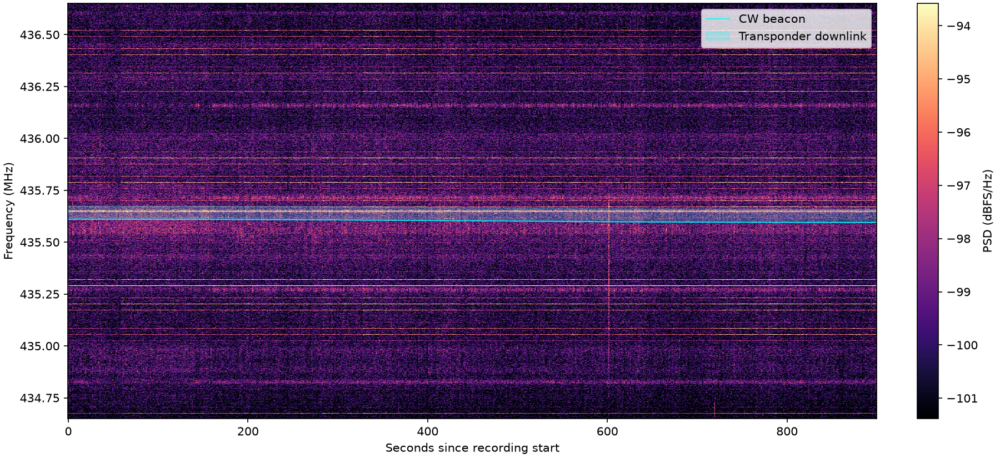

# RS-44 수신 기록 (2026-11-19)

01:05:37–01:20:37 KST에 RS-44 CW 비콘 대역(435.605 MHz)을 PlutoSDR로 녹음했습니다. LO는 435.650 MHz, RF 대역폭은 2 MHz였습니다. 3 MS/s CS16으로 899.635초를 기록했습니다.

## 패스 워터폴

흰 점선은 예측 도플러, 하늘색 실선은 예측에 −2,550 Hz를 더한 곡선입니다. 가로축은 녹음 시작 후 경과 시간이고, 세로축은 435.605 MHz 기준 주파수입니다.

위쪽의 밝은 점열은 비콘보다 약 10 kHz 높은 트랜스폰더 신호입니다(아래 트랜스폰더 신호 절).

## 도플러 편차와 잔차

배경보다 10 dB 이상 높은 스냅샷 33개의 피크를 썼습니다. 관측 피크와 −2,550 Hz를 적용한 예측 곡선 사이의 잔차 RMS는 51 Hz였습니다.

−2,550 Hz(−5.85 ppm)에는 수신기와 비콘의 주파수 오차, 시각 정렬 오차가 함께 반영됩니다. 도플러 최대 변화율이 33 Hz/s라 시각 오차만으로 이 편차가 생기려면 78초가 어긋나야 합니다. 대부분 주파수 오차입니다.

[`analyze_rs44.py`](../../scripts/analyze_rs44.py)로 다시 맞추면 −2,534 Hz, 잔차 RMS 43.5 Hz입니다.

## 트랜스폰더 신호

비콘 위 +10.0 kHz와 +10.35 kHz의 두 점열은 비콘과 같은 도플러 곡선을 따랐습니다. 보정한 주파수는 RS-44 트랜스폰더 다운링크 435.610–435.670 MHz에 들어갑니다. 두 점열은 FT4로 복조되는 지상국 신호였습니다. [AMSAT RS-44 규격](https://www.amsat.org/two-way-satellites/rs-44/)

`ft8_lib`로 CRC14를 통과한 FT4 43건을 복원했습니다. 서로 다른 메시지는 24개였습니다.

| 주파수 군(비콘 기준) | 관측 시각(KST) | FT4 |
| --- | --- | ---: |
| 약 435.6150 MHz (+10.0 kHz) | 01:08:16–01:16:46 | 13건 |
| 약 435.6153 MHz (+10.35 kHz) | 01:09:34–01:16:11 | 20건 |
| 435.6147 MHz | 01:08:03 | 1건 |
| 435.61603–435.61638 MHz | 01:11:03–01:16:48 | 9건 |

비콘 기준 약 435.642 MHz에서도 01:10:38–01:16:37에 버스트가 반복됐습니다. 강한 버스트 세 개의 길이는 2.6–2.8초, 90% 전력 대역폭은 395–497 Hz였습니다. 변조는 알아내지 못했습니다(USB, NFM, FT4/FT8, AFSK 1k2, FSK 9k6 시도).

같은 시간대 위성 48개의 궤도를 대조한 결과, 도플러가 맞는 신호는 RS-44에서만 잡혔습니다. UWE-4 예측선과 겹친 점도 RS-44 비콘에 더 잘 맞았습니다(잔차 RMS 19 Hz 대 63 Hz).

## CW 판독

비콘을 오디오로 내린 클립의 31.92초와 85.75초(녹음 기준 362초, 416초)에서 `.-. ... ....- ....-`(RS44)를 읽었습니다. 첫 R의 점, 선, 점은 0.20초, 0.54초, 0.19초입니다.

위쪽 스펙트로그램에는 650 Hz 부근의 키잉이, 아래쪽에는 600–700 Hz 대역의 포락선이 보입니다. 점선은 두 번의 호출부호 시작 위치입니다.

