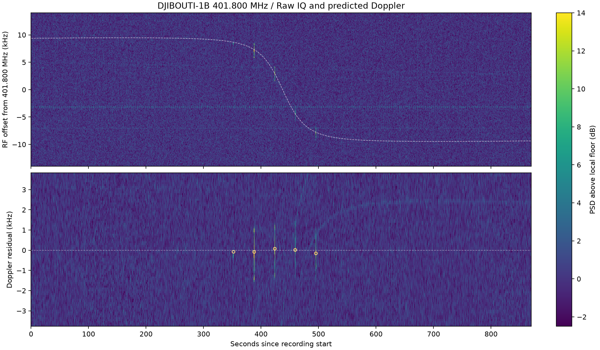
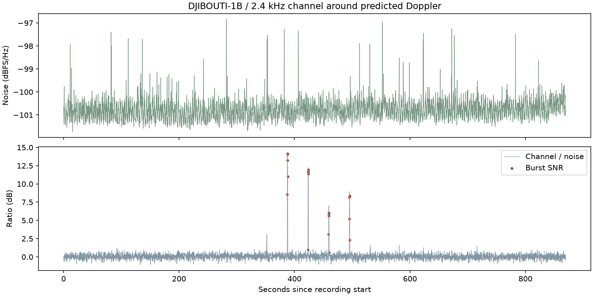

# DJIBOUTI-1B 수신 기록 (2026-11-24)

401.800 MHz에서 GMSK 버스트 5개 수신, AX.25 프레임 2개 FCS 통과.

- PlutoSDR, LO 401.675 MHz, RF 대역폭 600 kHz
- 3 MS/s CS16, 약 870초
- slow_attack, gain readback 73 dB

## 워터폴과 SNR

위쪽은 원본과 예측 도플러, 아래쪽은 도플러 보정 뒤 버스트의 중심 주파수. 예측과의 차이는 −155 Hz에서 +73 Hz 사이.



| 녹음 시작 후 (초) | 추정 SNR | FCS 통과 |
| ---: | ---: | ---: |
| 352.06 | 0.27 dB | 0 |
| 388.06 | 14.18 dB | 1 |
| 423.89 | 11.97 dB | 1 |
| 459.36 | 6.03 dB | 0 |
| 495.36 | 8.36 dB | 0 |

예측 도플러 중심의 2.4 kHz 대역 전력에서 양쪽 15–25 kHz로 잰 noise를 빼서 SNR 계산. Noise floor 중앙값 −100.80 dBFS/Hz.



## AX.25 디코딩

도플러 보정 IQ를 2,400 baud로 복조하고 NRZI와 HDLC bit unstuffing 적용. FCS를 포함한 두 프레임의 길이는 각 160 bytes. [개발팀 전송 규격](https://community.libre.space/t/for-djibouti-1b/12664)

처리 코드 [`analyze_djibouti1b.py`](../../scripts/analyze_djibouti1b.py)

```sh
uv run --locked python scripts/analyze_djibouti1b.py path/to/recording \
  --prediction path/to/prediction.json --tle path/to/djibouti1b.tle \
  --config config/local.toml --output path/to/new-analysis
```
