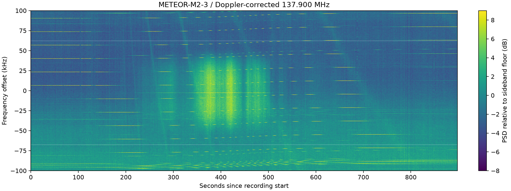
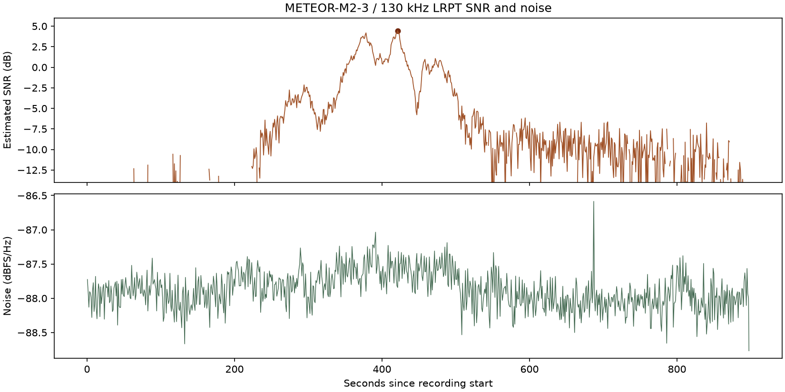
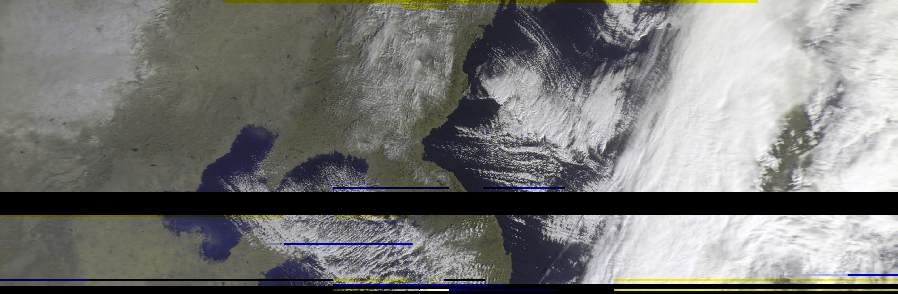
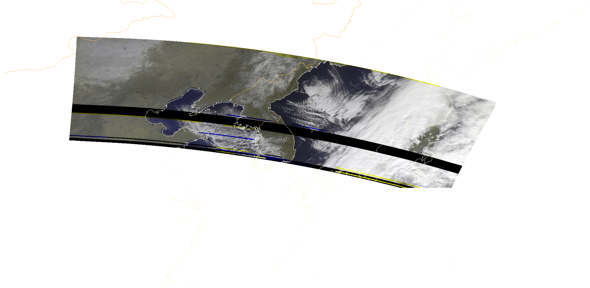

# METEOR-M2-3 오전 수신 기록 (2026-11-24)

137.900 MHz에서 72 kSym/s OQPSK LRPT 수신. Reed–Solomon 검사를 통과한 고유 CADU 1,104개로 MSU-MR 영상 복원.

- PlutoSDR, LO 137.775 MHz, RF 대역폭 600 kHz
- 3 MS/s CS16, 약 898초
- slow_attack, gain readback 73 dB

## 워터폴과 SNR

도플러 보정 뒤 워터폴. 가로 점선은 SNR 계산에 사용한 130 kHz 대역의 양끝.



최대 SNR 4.45 dB는 녹음 시작 후 421.26초. 130 kHz 채널 전력에서 양쪽 80–95 kHz의 PSD로 잰 noise를 뺌. Noise floor 중앙값 −87.84 dBFS/Hz.



## LRPT 디코딩과 영상

원본 IQ의 도플러를 보정하고 250 kS/s로 decimation. 110 kHz 필터 적용 후 디코딩. RRC α 0.45, PLL 대역폭 0.0006, timing α 0.015, IQ swap 1.



[채널 1 흑백](meteor3-morning/04-msu-mr-ch1.png), [채널 2 흑백](meteor3-morning/05-msu-mr-ch2.png)

위성 스캔 시각에 7초를 더해 해안선에 맞춤. 해안선과의 차이는 다섯 곳에서 2–9 km.



처리 코드 [`analyze_meteor3.py`](../../scripts/analyze_meteor3.py), SatDump 1.2.2

```sh
uv run --locked python scripts/analyze_meteor3.py path/to/recording \
  --prediction path/to/prediction.json --tle path/to/meteor-m2-3.tle \
  --config config/local.toml --output path/to/new-analysis --satdump path/to/satdump \
  --satdump-resources path/to/satdump-resources
```
